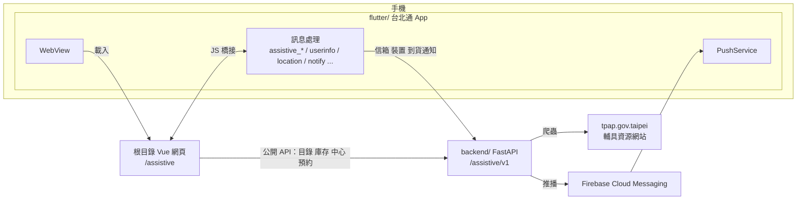

# TownPass-Services × 輔具通

台北通（TownPass）微服務專案。這個 repo 放了**輔具通**（App 內目前顯示為「輔具預約」）的全部程式：網頁微服務、台北通 App（Flutter）、後端（FastAPI），三個部分都在 `main`，clone 一次就齊。

> 主題：解決「用不到」。協助無法取得資源的人，更容易地受到協助。
> 輔具通把臺北市輔具資源中心的二手輔具借用、福利查詢、評估與維修申請，做成手機上走得完、長輩與照顧者也看得懂的流程。

## 目錄結構

```
.
├── src/                    網頁微服務（Vue 3 + Vite + Tailwind + Pinia），跑在 App 的 WebView 裡
│   ├── views/assistive/        輔具通的頁面（進入點 /assistive）
│   ├── components/assistive/   輔具通專用元件
│   ├── utils/assistive/        後端呼叫、App 橋接、目錄與中心資料、推播註冊
│   ├── stores/assistive*.ts    流程狀態（Pinia）
│   ├── router/assistive.ts     輔具通路由
│   ├── i18n/assistive/         中文與英文字串
│   └── data/                   官網爬下來的靜態資料（福利、衛教、庫存快照）
├── flutter/                台北通 App（Flutter），含輔具通需要的橋接與推播
│   ├── lib/service/            assistive_backend_service、push_service、data_authorization_service
│   ├── lib/util/web_message_handler/   網頁 ↔ App 的訊息處理
│   └── docs/                   assistive-booking-dev.md（建置）、push-notifications.md（推播）
├── backend/                輔具預約後端（FastAPI），API 基準路徑 /assistive/v1
│   ├── app/                    routers → features → tools（含爬蟲與 FCM）
│   └── docs/                   API.md（完整 API）、FRONTEND.md（前端串接）
└── scripts/assistive/      重新爬取衛教文章
```

## 架構



**誰負責什麼**

| 部分 | 負責 | 不負責 |
|---|---|---|
| 網頁 | 所有畫面與流程；讀目錄、庫存、中心、行事曆；建立、查詢、取消預約（預約的 `access_key` 存在網頁） | 不碰 `mailbox_key`；不直接處理推播 |
| Flutter App | 保管信箱金鑰（secure storage）；登記推播裝置；新增、取消、列出到貨通知；使用者資料與位置的授權；電話、地圖、開連結；點推播開對應頁面 | 不做畫面流程 |
| 後端 | 目錄／庫存／中心資料（爬官網，失敗時用備份）；預約、信箱、到貨訂閱；逾期掃描與取貨提醒；FCM 推播 | 目前不送件到中心（見「尚未完成」） |

網頁與 App 之間的訊息：`userinfo`、`location`、`phone_call`、`launch_map`、`open_link`、`notify`，以及輔具通專用的 `assistive_mailbox`、`assistive_subscribe`、`assistive_subscriptions`、`assistive_push`。使用者資料與位置要先在 App 的授權視窗同意，沒同意時回傳空值。

沒有設定 `VITE_ASSISTIVE_API_BASE` 時，網頁改用瀏覽器 localStorage 模擬後端，可以不開後端、不開 App 單獨看畫面。

## 輔具通功能

- **二手輔具借用**：須知與同意 → 選輔具（顯示剩餘數量與等待人數）→ 選取貨中心（只列在取貨期限內可前往的日期）→ 確認資料（台北通授權帶入聯絡資料）→ 預約成功頁。
- **到貨通知**：缺貨時登記，到貨後推播並可一鍵預約。
- **預約查詢與取消**：首頁顯示進行中的預約與取貨期限；詳情可打電話、導航、取消。
- **輔具評估、維修**：與官網合併的申請表，可替家人填寫；依居住行政區分派中心。
- **福利查詢**：官網問答流程，13 項福利方案。
- **輔具衛教**：15 篇文章，影片內嵌。
- **無障礙與多語**：依 WCAG 2.1 AA 設計（對比、44px 觸控區、鍵盤焦點、減少動態效果、字放大到 400%），中文與英文。

文案以官網用字為準，不另外改寫。

## 本機執行

三個部分可以只開需要的。

**網頁**（repo 根目錄）

```sh
pnpm install
cp .env.development.example .env.development   # 要連後端時填 VITE_ASSISTIVE_API_BASE
pnpm dev                                         # 進 App 要加 --host 0.0.0.0 --port 5173
```

打開 `http://localhost:5173/assistive`。加上 `?mockUser=1` 會用假的使用者資料預填聯絡資訊（只在開發模式）。

```sh
pnpm build        # 型別檢查與打包
pnpm lint         # ESLint（會自動修正）
```

**後端**（`backend/`）

```sh
cd backend
python -m venv .venv && source .venv/bin/activate
pip install -r requirements.txt
cp .env.example .env        # TEST_MODE=true 時用假資料，不連官網
python app/main.py          # 位址在 .env 的 HOST、PORT（範本是 192.168.88.208:8000，改成自己的），文件在 /docs
pytest
```

推播要設定 `FCM_PROJECT_ID` 與 `FCM_CREDENTIALS_FILE`（Firebase 服務帳號金鑰，**不要 commit**）；沒設定時推播只記錄在本機。完整說明見 [backend/README.md](backend/README.md)。

**App**（`flutter/`，Android 為主）

```sh
cd flutter
flutter pub get
dart run build_runner build
flutter build apk --debug --target-platform android-arm64 \
  --dart-define=ASSISTIVE_API_BASE=http://<後端位址>:8000/assistive/v1 \
  --dart-define=ASSISTIVE_URL=http://<電腦區網 IP>:5173/assistive
```

預設值只適用 Android 模擬器（`10.0.2.2`）。Firebase 設定、真機與常見問題見 [flutter/docs/assistive-booking-dev.md](flutter/docs/assistive-booking-dev.md) 與 [flutter/docs/push-notifications.md](flutter/docs/push-notifications.md)。

App 內開啟路徑：「服務」分頁 →「輔具預約」。

## 三端對應的設定

| 設定 | 位置 | 說明 |
|---|---|---|
| `VITE_ASSISTIVE_API_BASE` | 網頁 `.env.development` | 後端網址（含 `/assistive/v1`）；不設定就用 localStorage 模擬 |
| `ASSISTIVE_API_BASE` | Flutter `--dart-define` | App 呼叫後端的網址，應與上面同一台 |
| `ASSISTIVE_URL` | Flutter `--dart-define` | App 載入的網頁網址 |
| `FIREBASE_*`、`PUSH_DEV_TOKEN` | Flutter `--dart-define` | 推播；沒帶就沒有推播，App 照常運作 |
| `TEST_MODE`、`HOST`、`PORT`、`FCM_*` | 後端 `.env` | 見 backend/README.md |

## 尚未完成

- 後端不送件到中心：`FORWARD_TO_CENTER = False`，預約只記錄在後端，還沒有任何申請會送到實際的中心系統，需先確定介接方式。
- 推播只在 Android 模擬器驗證過真實 FCM；iOS 需要 APNs 金鑰與 Push 能力設定，尚未測試。
- 個資使用聲明的法律文字是草稿，需市府確認。
- 無障礙是依規範設計與自行檢查，尚未做螢幕閱讀器與真機的完整測試。
- App 內名稱目前仍是「輔具預約」，尚未改成「輔具通」。

## 其他文件

- 後端 API：[backend/docs/API.md](backend/docs/API.md)、前端串接：[backend/docs/FRONTEND.md](backend/docs/FRONTEND.md)
- 推播：[flutter/docs/push-notifications.md](flutter/docs/push-notifications.md)
- 貢獻指南：[CONTRIBUTING.md](CONTRIBUTING.md)

## 來源

- 網頁：fork 自 [taipei-doit/TownPass-Services](https://github.com/taipei-doit/TownPass-Services)。
- `flutter/`：[taipei-doit/TownPass](https://github.com/taipei-doit/TownPass) 加上輔具通的修改（來自 `creaper9487/TownPass` 的 `wip/assistive-booking`，快照於 `cc4b1c4`，沒有帶歷史）。
- `backend/`：[ZackerySunch/taipei-codefest-2026-Backend](https://github.com/ZackerySunch/taipei-codefest-2026-Backend) 的 `developer`（`5298d52`），以 subtree 匯入並保留 commit 歷史。
